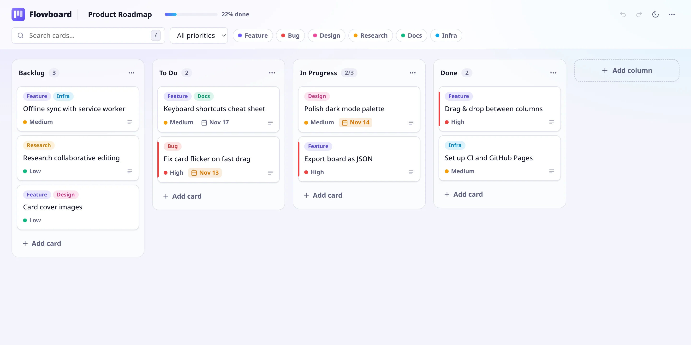

<div align="center">


# Flowboard

**A fast, offline-first Kanban board. Drag & drop, labels, search and dark mode, all in your browser.**

[](https://github.com/nvmchris/flowboard/actions/workflows/ci.yml)
[](https://github.com/nvmchris/flowboard/actions/workflows/deploy.yml)


[](LICENSE)

### [Live demo →](https://nvmchris.github.io/flowboard/)

<picture>
  <source media="(prefers-color-scheme: dark)" srcset="docs/screenshot-dark.webp" />
  
</picture>

</div>

## Features

- **Drag & drop** cards between columns and reorder the columns themselves, with mouse, touch or keyboard
- **Rich cards** with labels, priorities (low, medium, high), due dates (overdue ones are highlighted) and descriptions
- **WIP limits** per column. The counter turns red when a column gets overloaded
- **Search & filters** by text, label and priority
- **Undo / redo** for every change, including a whole drag in one step
- **Import / export** the board as JSON to back it up or move it to another device
- **Light & dark theme** that follows your system and can be toggled with one key
- **Offline-first**: no account, no server. Everything is stored in `localStorage`
- **Accessible**: native `<dialog>` modals, ARIA labels, a visible focus ring and reduced-motion support
- **Responsive**: columns snap into place on phones

## Keyboard shortcuts

| Key | Action |
| --- | --- |
| <kbd>N</kbd> | New card in the first column |
| <kbd>/</kbd> | Focus search |
| <kbd>T</kbd> | Toggle light / dark theme |
| <kbd>Ctrl</kbd> + <kbd>Z</kbd> | Undo |
| <kbd>Ctrl</kbd> + <kbd>Shift</kbd> + <kbd>Z</kbd> | Redo |
| <kbd>Space</kbd>, then arrow keys | Pick up a focused card and move it |
| <kbd>Enter</kbd> | Open the focused card |
| <kbd>?</kbd> | Show all shortcuts |

## Tech stack

| Area | Choice |
| --- | --- |
| UI | [React 19](https://react.dev) and plain CSS with custom properties (no UI framework) |
| Language | [TypeScript](https://www.typescriptlang.org) in strict mode |
| Drag & drop | [dnd-kit](https://dndkit.com) |
| Build | [Vite](https://vite.dev) |
| Tests | [Vitest](https://vitest.dev) and [Testing Library](https://testing-library.com) |
| CI/CD | GitHub Actions to GitHub Pages |

## Getting started

Requires Node.js 20.19 or newer.

```bash
git clone https://github.com/nvmchris/flowboard.git
cd flowboard
npm install
npm run dev
```

Then open <http://localhost:5173>.

| Script | What it does |
| --- | --- |
| `npm run dev` | Start the dev server with hot reload |
| `npm run build` | Typecheck and build for production into `dist/` |
| `npm run preview` | Serve the production build locally |
| `npm test` | Run the test suite |
| `npm run lint` | Lint the code with ESLint |

## Project structure

```
src/
├── components/     UI components (columns, cards, dialogs, header, menus)
├── hooks/          useTheme, useHotkeys
├── store/
│   ├── boardReducer.ts   all board state changes as a pure, tested reducer
│   ├── useBoard.ts       state, undo/redo history and drag transactions
│   ├── storage.ts        localStorage persistence and import validation
│   └── seed.ts           demo board shown on first visit
├── utils/          filtering, due dates, ids
├── types.ts        domain model (Board, Column, Card, Label)
└── App.tsx         layout and drag & drop wiring
```

### How it works

All changes to the board go through a single pure reducer
([`boardReducer.ts`](src/store/boardReducer.ts)), so every action is easy to test and
undo. `useBoard` wraps it with a history stack. While a drag is in progress, all the
intermediate moves are grouped into one transaction, so a single <kbd>Ctrl</kbd>+<kbd>Z</kbd>
reverts the whole drag, and cancelling a drag with <kbd>Esc</kbd> restores the board exactly.

## Roadmap

- [ ] Multiple boards
- [ ] Custom labels editor
- [ ] Checklists inside cards
- [ ] Real-time collaboration (CRDT based)
- [ ] Installable PWA with offline caching

## License

[MIT](LICENSE) © nvmchris
